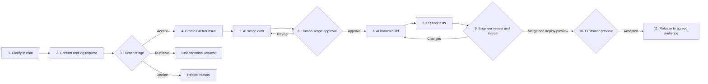

# Workflow and data contract

Status: full-flow reference proposal; backend/API/tool sections are deferred under the current local/frontend scope.
Updated: 2026-11-19. Sources: A and B as defined in the scope document.

## Active feature boundary

The implemented MVP is chat → saved confirmed request → Git-ready issue brief. The latest owner instruction adds Vite-managed local CSV persistence with Master/all and Administrator/own visibility, superseding download-only storage. Drafts stay in the browser; optional summary CSV downloads remain. The same Vite runtime forwards AI calls with environment keys and verifies the final BeWhere login exchange to establish server sessions. See [mvp-ticket-capture.md](mvp-ticket-capture.md) for actual behavior and D-16 through D-18. The lifecycle below remains full-flow reference, not a claim that all its states/services exist.

AutoLoop runs locally. Requested features may change frontend screens, components, styles, interactions, accessibility, and related tests. They must not require API contract changes, new endpoints, backend services, or tool development. Preserve the existing BeWhere sign-in.

Automatic GitHub submission and coding/review/release orchestration remain deferred. The POC implements only local CSV writes and verified-session ticket ownership/role checks from the broader data design below. It uses one ignored .data/requests.csv with full confirmed records in a quoted JSON cell, no transcript/event sidecars or automated backups. The larger webhook, approval, rollout, and production storage designs remain future reference. A model call is real only when the provider returns validated output; no simulated AI success or external action is reported.

## The 11 steps



Steps 1–3 and 10–11 are in the app; 4–9 are in GitHub. Scope questions about intent return to the requester through the app. Source: A P008–P062; B P055–P057. Preview feedback behavior is described below rather than implying an unapproved build loop.

## Lifecycle and authority

| State | Entry event and actor | Required evidence / next action |
| --- | --- | --- |
| Draft | Customer starts a conversation | Private conversation; no external issue or coding work. |
| Submitted | Customer confirms the summary; backend saves | Immutable request ID, owner, confirmed summary, transcript reference, submitted time. |
| Accepted | Product owner accepts | Human decision, sanitized functional brief. Create/link the issue, then begin Scoping. |
| Merged into another request | Product owner identifies a duplicate | Canonical request ID, reason, and recorded actor. This is a request merge, distinct from a code/PR merge. |
| Declined | Product owner declines | Human reason visible to the requester; no issue/build is initiated. |
| Scoping | Linked issue is ready; agent drafts scope | Scope revision, acceptance criteria, outstanding questions. No implementation changes. |
| Approved | Authorized product owner applies `approved` to that scope | Human identity, timestamp, revision/hash; no unresolved intent questions. |
| Building | Authorized agent run starts | Matching approval, run ID, branch, and approved scope revision. |
| In review | Agent opens PR with tests | Linked request/issue, CI results, automated first review, then engineer decision. |
| Preview | Engineer merged; deployment succeeds; product owner selects audience | PR/merge commit, deployed revision, flag grants, preview-ready time. Merge alone is insufficient. |
| Shipped | Human executes release after requester acceptance | Acceptance against deployed revision, release audience, release actor, timestamp. |

Source vocabulary: B P098. Draft may exist in the transcript before a CSV row is created; the log is created on confirmed submission, as in A P020. Keep one stable display vocabulary; define machine codes when implementing.

Proposed exception rules:

- Customer clarifications leave the request in Scoping with a separate waiting reason; record questions, answers, and timestamps. The backend/operator relays a sanitized answer to the issue.
- A changed scope invalidates its approval. Removing approval stops new runs; cancel any active run where supported, and block merge/release until the new scope is approved.
- A new commit after engineering approval must pass required checks and the repository's renewed review rules before merge.
- Preview feedback records missing behavior. A defect within approved scope returns through build/tests/review/preview. A changed requirement returns to Scoping and needs fresh approval. Earlier evidence is retained; acceptance for an old revision cannot release a new revision.
- A duplicate request does not create another issue/build. Keep its requester informed using a customer-safe projection of the canonical request; never expose the canonical customer's identity/transcript. Exact duplicate rollout behavior is D-08.
- Failed integration work keeps the last truthful state plus an error/retry record. Do not mark Building, Preview, or Shipped merely because a trigger was sent.
- Rejection at scope or PR review is recorded; proposal: product owner closes as Declined with history and reason. Confirm this exception path in D-09.

## Four human decisions

1. Product owner accepts, merges, or declines a submission.
2. Product owner approves a particular scope, requests changes, or rejects it; engineer helps on technical points.
3. Engineer reviews after Codex's first pass, requests changes, merges, or closes the PR.
4. Requester confirms the preview or reports what is missing; product owner controls who can access it.

The product owner's release action executes the accepted outcome; it is not a replacement for requester acceptance or an extra AI approval. Production deployment remains human-controlled. Sources: A P060–P062; B P104–P126, P051.

## Backend and identity boundary

Deferred full-flow architecture proposal: keep the React frontend and add a small Node/TypeScript backend owning chat/model calls, request files, operator actions, GitHub credentials/events, preview grants, and measurement records. Local operation is now confirmed, but adding this backend is not part of the active frontend feature scope. No runtime framework/provider has been selected.

Browser session storage is a navigation convenience, not backend authorization. Before any request-data endpoint is enabled, verify a supported BeWhere token-validation mechanism and derive the stable user/account identity on the server. Do not trust posted customer IDs or browser role values. Never reuse the CSV as an authentication authority. Validation failures/expired tokens deny access.

Proposed permissions: customers access their own requests; named operators manage triage; named engineers handle code/deployment. Keep user and BeWhere account IDs distinct. Do not map all Administrator/Dealer/Master users to AutoLoop operator privileges without a decision.

Source: B P131–P140 plus the current BeWhere authentication requirement. Validation endpoint, identity model, and operator mapping are launch blockers in D-03/D-04.

## Durable private storage

Source baseline CSV header, preserved exactly [B P096–P103]:

```csv
request_id,created_at,customer_id,customer_name,summary,status,github_issue,transcript_file,submitted_at,triaged_at,approved_at,merged_at,shipped_at,notes
```

One transcript file per request contains the conversation and confirmed summary. `transcript_file` is a controlled relative path, never an arbitrary browser-supplied filesystem path. Runtime files, backups, and private sidecars must live under a configured directory outside the repository and outside any public static root. `.plan/` stores planning material only, never pilot CSVs or transcripts.

Proposed small extensions, required because the source columns do not fully support its gates/metrics:

| Record | Additional information | Reason |
| --- | --- | --- |
| CSV columns | `requester_user_id`, `account_id`, `canonical_request_id`, `github_pr`, `preview_ready_at`, `preview_confirmed_at` | Ownership, distinct request merging, PR traceability, preview lead time and acceptance. Define `customer_id` explicitly before migration. |
| Private events file | Request ID; event ID; previous/new state; actor; UTC timestamp; decision reason; source delivery/run ID; reviewed/deployed revision; human minutes and change rounds | Audit four gates, measure effort, invalidate stale approvals, and deduplicate GitHub deliveries without overloading `notes`. |
| Private flag file | Feature key; request ID; permitted users/groups; deployed revision; preview/global setting; actor/time | Default-off preview access and explicit release history. |

These remain files, not a production database. Agree schemas before the pilot; maintain a documented mapping for later database import. A CSV row is the current-state projection; append-only events preserve history. Partial writes must be recoverable rather than leaving mismatched status and approval evidence.

One backend process is the sole writer. Serialize changes, allocate IDs safely, use a CSV parser/writer that handles quoting/newlines, and replace files atomically where possible. Make submissions and integrations idempotent. Do not run multiple independent server instances over local CSV files. Back up daily and test a restore before admitting real pilot records. Retention/deletion is D-10.

## GitHub and agent boundary

- GitHub receives only the accepted, reviewed functional brief, opaque request ID, approved scope, and technical discussion. No CSVs, transcripts, customer names/emails, tokens, or private attachments are copied to code, issues, PRs, or build artifacts.
- Product documentation/feature lookup is read-only. Customer-facing duplicate lookup returns only authorized or sanitized matches; operator lookup may see the full permitted request set.
- DeepSeek chat cannot read/change code, call admin actions, add labels, promise dates, or modify customer business data. A distinct backend submission action records the request after customer confirmation; do not expose unrestricted write tools to the model.
- Verify the GitHub sender and allowed repository, event signature, human actor authority, approved scope revision, and current state before a build or status transition. A label string alone is not authorization.
- Codex scopes first, then builds only on approval. Give it branch/PR permissions, with repository protection denying merge/main writes/deployment. Test secrets, if unavoidable, are minimal and isolated; prefer mocked tests. A trusted preview deployment may use the development BeWhere account, never pilot customer credentials.
- Webhook handling is server-side and replay-safe. Local-first operation may use an explicitly configured public tunnel or an operator-triggered GitHub reconciliation command through the backend; final webhook delivery must be exercised before the pipeline gate. Manual starts may not bypass human approvals.
- Weekly budget checks, configured abuse limits, workflow/token revocation, and removal of queued/active work must form a tested stop procedure. Removing a workflow file alone must not be assumed to cancel already-running jobs.

These are proposed controls implementing B P070, P093–P094, P103, P126, P130–P140. Availability of the named model, Codex trigger/review mode, and exact permissions must be verified against the providers' current official documentation during setup; this review has not tested those external integrations.

## Preview and release semantics

Feature grants are enforced against server-validated identities; hiding a frontend control alone cannot protect a data endpoint. A feature defaults off. After human merge, an engineer makes a flagged revision available in the agreed preview environment. The product owner selects requester/additional users, the requester records acceptance for that revision, and the product owner executes the agreed rollout. The backend updates Shipped only after the rollout succeeds.

For the experiment, recommendation: “everyone” means the agreed pilot/demo audience. It does not imply deployment to live BeWhere customer production. Confirm D-05 before implementation. Revocation/rollback must be possible if the preview or release is faulty; test the flag independently of data/schema changes.
